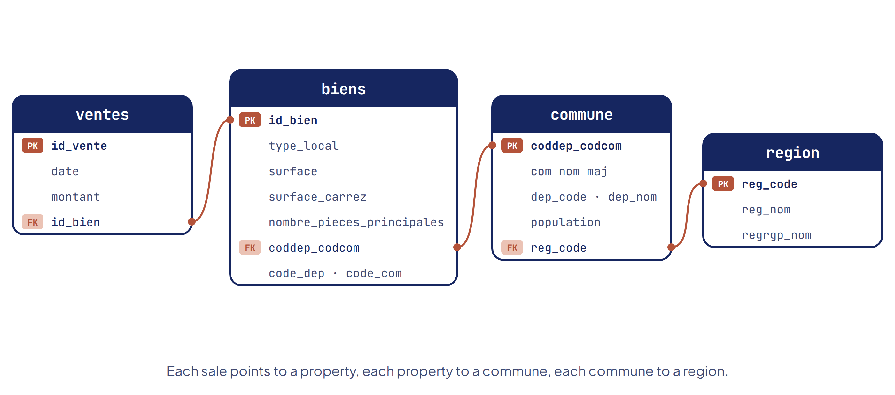

# How did the French property market hold up in early 2020?

A relational database built from public property sales (DVF), INSEE and geographic data, then twelve SQL queries on volumes, prices and local dynamics in the first half of 2020, first lockdown included.

**Full case study:** [axeldrtdata.github.io/works/french-property-market-sql](https://axeldrtdata.github.io/works/french-property-market-sql/)

## Context

Laplace Immo, a national network of estate agencies (fictional OpenClassrooms case), wanted a proof of concept: a relational database of property sales that its teams could query to understand the French market in the first half of 2020.

## The database



Four tables linked by foreign keys (`ventes` → `biens` → `commune` → `region`), documented in the [data dictionary](docs/data-dictionary.md). Sources: DVF property sales, INSEE population by commune, data.gouv geographic reference.

**Data-type audit**: three silent issues were found and fixed by [`sql/00_fix_data_types.sql`](sql/00_fix_data_types.sql): dates stored with slashes (ISO filters returned nothing), Carrez surfaces and 237 sale amounts stored as text with a decimal comma (truncated in calculations, wrongly sorted). The database in this repository is the corrected version.

**GDPR**: public data; in this public version, street addresses were removed from the database (an address combined with a price and a date can point to a person); and a ready-to-use right-to-erasure query ([`sql/13_right_to_erasure.sql`](sql/13_right_to_erasure.sql)) that deletes explicitly, without cascading deletes.

## The twelve queries

| # | Question | Result |
| - | -------- | ------ |
| 01 | Apartments sold in H1 2020 | 31,378 |
| 02 | Apartment sales by region | Île-de-France 13,995 (45%), PACA 3,649, Auvergne-Rhône-Alpes 3,253 |
| 03 | Share of apartment sales by rooms | 2 rooms 31.2%, 3 rooms 28.6%, 1 room 21.5%: 81% for 1 to 3 rooms |
| 04 | Top 10 departments by price per m² | Paris €12,049, Hauts-de-Seine €7,219, Val-de-Marne €5,339 |
| 05 | Price per m² of a house in Île-de-France | €3,998 |
| 06 | 10 most expensive apartments | All in Île-de-France, from €6.6M to €9M |
| 07 | Sales growth Q1 → Q2 2020 | 16,776 → 17,393 (+3.68%) |
| 08 | Regions by price per m² of 5+ room apartments | Île-de-France €8,753, La Réunion €3,642, PACA €3,587 |
| 09 | Communes with 50+ sales in Q1 | 48 communes, led by Paris 17th (228), 15th (215), 18th (209) |
| 10 | Price per m²: 2 rooms vs 3 rooms | €4,906 vs €4,299 (−12.4%) |
| 11 | Top 3 communes per department (06, 13, 33, 59, 69) | Window function `ROW_NUMBER() OVER (PARTITION BY ...)`; Saint-Jean-Cap-Ferrat €968,750 |
| 12 | Top 20 communes (10,000+ inhabitants) by sales per 1,000 inhabitants | Paris 2nd (5.84), Paris 1st (4.92), Paris 3rd (4.69) |

## Repository structure

```
french-property-market-sql/
├── database/
│   └── laplace_immo.db           # SQLite database (corrected data types)
├── sql/
│   ├── 00_fix_data_types.sql     # data-type audit and fixes
│   ├── 01_… to 12_….sql          # the twelve business queries
│   └── 13_right_to_erasure.sql   # GDPR, article 17
└── docs/
    ├── schema.png
    ├── data-dictionary.md
    └── data-dictionary-original-fr.xlsx
```

## How to run it

Open `database/laplace_immo.db` in SQLiteStudio or DB Browser for SQLite, or from the terminal:

```bash
sqlite3 database/laplace_immo.db < sql/04_top10_departments_price_m2.sql
```

## Limitations

- One semester only, which makes it hard to separate seasonal and lockdown effects. DVF records the date of the notarial deed, signed two to three months after the agreement: Q2 deeds largely reflect agreements made before the lockdown.
- Averages of prices per m² are sensitive to DVF outliers (bulk sales recorded against a single unit); rankings were checked against medians and hold.
- The quarterly comparison (query 07) counts all property types.

## Stack

SQL · SQLite · SQLiteStudio · Excel

## Note

The project was first built in French during my OpenClassrooms Data Analyst training. Queries, comments and documentation have been translated into English; table and column names are kept as in the original database.

---

Axel Derobert · Data Analyst · [Portfolio](https://axeldrtdata.github.io) · [LinkedIn](https://www.linkedin.com/in/axel-derobert-5717463b1/)
